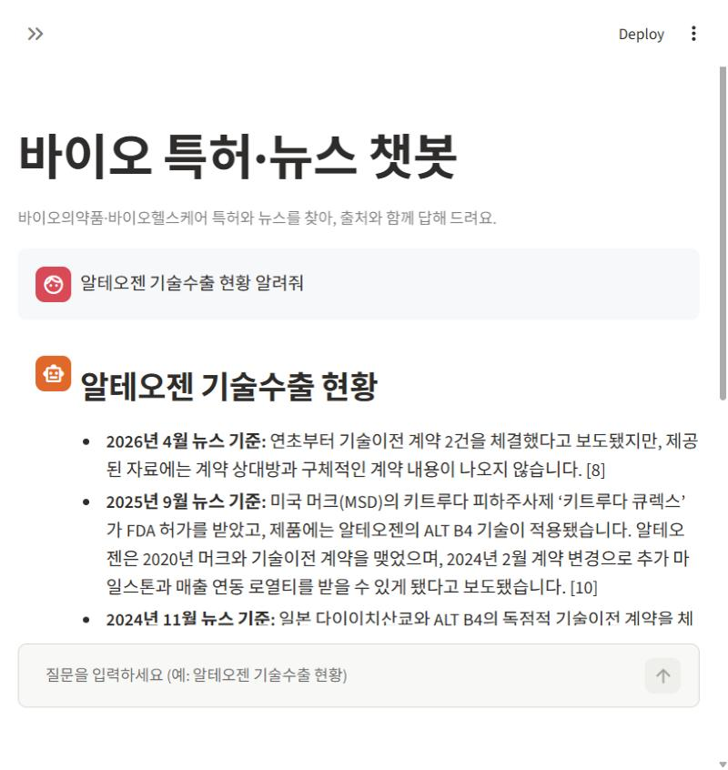
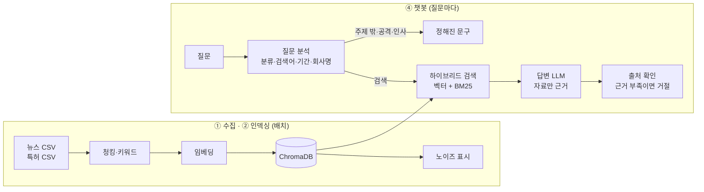

# 바이오의약품·바이오헬스케어 RAG 챗봇

바이오헬스 뉴스와 키프리스(KIPRIS) 등록 특허를 검색해, **검색된 자료만 근거로 출처 번호를 붙여 답하는** 챗봇이에요.
OpenAI API, LangChain, ChromaDB, Streamlit으로 만들었어요.

- 자료: 뉴스 32,168건(2021-10-16 ~ 2026-10-16), 특허 8,790건(바이오의약품 7,152 + 바이오헬스케어 1,638)
- 검색: 의미 검색(벡터)과 단어 검색(BM25)을 합친 하이브리드 검색 + 노이즈(바이오 무관 문서) 필터 + 회사명 필터
- 답변: 질문 분석 → 검색 → 답변 → 출처 확인. 근거가 없거나 주제 밖·조언 요청이면 거절하거나 판단 없이 사실만 답함
- 화면: 멀티턴 대화, 답변 아래에서 출처 원문 확인, 평가 결과 대시보드

<!-- 스크린샷: 챗봇 화면을 캡처해 report/screenshots/chat.png로 저장한 뒤 아래 줄의 주석을 풀어 주세요.

-->

## 결과 요약 (최종 v5)

| 구분 | 지표 | 결과 |
|---|---|---|
| 검색 | Hit@3 (원래 질문, 뉴스 / 특허) | 92.5% / 93.0% |
| 검색 | Hit@3 (표현 바꾼 질문, 뉴스 / 특허) | 83.9% / 74.6% |
| 검색 | 질문 1개당 검색 시간 | 평균 0.63초 |
| 답변 | 정답 (단순 사실 질문 164개) | 93.9% |
| 답변 | 근거 있음 (답변 내용이 인용 자료에 있음) | 96.3% |
| 답변 | 거절 적절성 (197개) | 98.5% |
| 답변 | 실패 | 20 / 197 |

- Hit@3 = 검색 상위 3개 안에 정답 문서가 있는 질문의 비율
- 버전별 비교(v1~v7)는 [report/README.md](report/README.md), 실험 기록은 [eval/results/experiments.md](eval/results/experiments.md)

## 전체 구조

```
[1] 사용자·질문 정의
[2] 평가셋: 단순 사실 250 + 표현 바꾼 250 (검색기 1차 구현 후) + 설계 보완 60 (v6)

 ┌──────────┐      ┌────────────┐      ┌──────────────┐      ┌──────────┐
 │ ① 수집기  │ ───▶ │ ② 인덱서    │ ───▶ │ ③ 저장        │ ◀─── │ ④ 챗봇    │
 │ 제공 뉴스  │ 저장  │ 청킹·키워드  │ 적재  │ ChromaDB      │ 검색  │ RAG·UI   │
 │ +키프리스  │      │ ·임베딩     │      │ + BM25 + 원문 │      │ 조회 전용 │
 │ (수작업)   │      │ ·노이즈·검증 │      │ (retriever만) │      │          │
 └──────────┘      └────────────┘      └──────────────┘      └──────────┘
   배치 실행           배치 실행            단일 접점              상시 실행
                                                                   │
                                                  [평가 하네스] ← 같은 rag.chain 호출
                                                                   ↓
                                  [3] 측정 → 원인 계층 → 변수 1개 변경 → 재측정 → 기록
```

- **① 수집기** (`collector/`): 제공 뉴스 CSV와 키프리스에서 직접 내려받은 특허 CSV를 확인·불러오기
- **② 인덱서** (`indexer/`): 청킹 → 특허 키워드 → 임베딩 → 노이즈 표시 → 검증 (배치)
- **③ 저장** (`store/`): ChromaDB + BM25 색인 + 원천 파일. DB 접근은 `rag/retriever.py` 하나로만
- **④ 챗봇** (`rag/`, `app/`): 질문 분석 → 검색 → 답변 → 출처 확인. DB는 읽기만 함
- **평가 하네스** (`eval/`): 챗봇과 같은 체인을 불러 측정하고, 변수 하나씩 바꿔 재측정 ([eval/README.md](eval/README.md))

## 구조

```
project3/
├── README.md
├── .env.example              # 키 이름만 (OPENAI_API_KEY)
├── requirements.txt
├── config.py                 # 모든 경로 설정 (폴더를 옮길 때 여기만 수정)
├── notebooks/                # 초기 탐색 스크립트 (특허 키워드 추출 방법 비교)
│
├── collector/                # ① 수집 계층
│   ├── __main__.py           #   python -m collector → 원천 데이터 확인
│   └── storage.py            #   원천 파일 위치·불러오기·검사
│
├── indexer/                  # ② 인덱싱 계층 (배치)
│   ├── __main__.py           #   python -m indexer <단계>
│   ├── chunk.py              #   뉴스 문장 단위 청킹 (1,000자 / 겹침 150자)
│   ├── keywords.py           #   특허 분야태그·핵심키워드 (규칙 + LLM)
│   ├── embed.py              #   임베딩 → ChromaDB 저장 (이어서 처리)
│   ├── noise_news.py         #   뉴스 노이즈 판정 (규칙 + LLM → 분류 모델)
│   ├── noise_patent.py       #   특허 노이즈 판정 (IPC/CPC 규칙 + LLM)
│   ├── verify.py             #   적재 검증
│   └── background.py         #   긴 작업을 백그라운드로 실행
│
├── store/                    # ③ 저장 계층 (GitHub에 올리지 않음)
│   ├── raw/                  #   원천 데이터 (뉴스 CSV, 특허 CSV)
│   ├── processed/            #   뉴스 청크, 특허 키워드
│   ├── chroma/               #   벡터 DB
│   ├── bm25/                 #   BM25 색인 (첫 검색 때 자동 생성)
│   └── noise/                #   노이즈 판정 결과·분류 모델
│
├── rag/                      # 체인 (챗봇과 평가가 공유)
│   ├── retriever.py          #   하이브리드 검색 (벡터 1 : BM25 2, RRF) + 필터
│   ├── chain.py              #   LangChain RAG 체인 (분석 → 검색 → 답변 → 출처 확인)
│   └── prompts.py            #   시스템 프롬프트·질문 분석 지시문·거절 문구
│
├── eval/                     # 평가 하네스
│   ├── eval_set/             #   평가 질문 (250개 + 표현 바꾼 250개 + 설계 보완 60개)
│   ├── harness.py            #   평가 질문 생성 + 청킹 설정 비교
│   ├── judge.py              #   정답급 문서·질문 품질 판정 (LLM)
│   ├── retriever_eval.py     #   검색 방식·가중치 비교
│   ├── bootstrap_ci.py       #   부트스트랩 신뢰구간
│   ├── run_eval.py           #   답변 품질 평가 (정답성·근거성·거절 적절성·실패 유형)
│   ├── refusal_eval.py       #   거절 정확도 (근거 없는 질문 15개)
│   ├── failure_layers.py     #   실패 원인 계층 (데이터·전처리·인덱싱·검색·생성)
│   ├── experiment.py         #   단일 변수 실험 → 재측정 → 비교(신뢰구간) → 기록
│   ├── diagnose_misses.py    #   (예전) 검색 실패 원인 진단
│   ├── smoke_test.py         #   실사용 질문 점검 + 속도 (smoke_test2.py: 새 질문 15개)
│   ├── design_questions.py   #   비교·시점·종합·답변 불가 질문 생성 (v6·v7 실험용)
│   ├── prompts/              #   프롬프트 실험용 지시문
│   └── results/              #   태그별 결과 (v1~v7, 실험) + experiments.md
│
├── api/server.py             # ④ 챗봇 API (외부 화면용, 조회 전용)
├── lovable/                  #   Lovable 화면용 프롬프트·로직 코드 (PROMPT.md)
├── app/                      # ④ 챗봇 UI (조회 전용)
│   ├── main.py               #   streamlit run app/main.py
│   ├── chat.py               #   대화 화면
│   └── dashboard.py          #   평가 결과 시각화
└── report/                   # 결과 정리
```

## 동작 흐름



## 설치

Python 3.12 환경 기준이에요.

```bash
pip install -r requirements.txt
cp .env.example .env        # .env에 OPENAI_API_KEY 입력 (.env는 GitHub에 올리지 않음)
```

## 데이터 준비

원천 데이터는 저장소에 없어요. 아래 파일을 `store/raw/`에 넣어 주세요 (이름은 `config.py`에 있음).

| 파일 | 내용 |
|---|---|
| `04_바이오헬스_묶음_바이오헬스케어_2021-10-16~2026-10-16_중복제거.csv` | 제공받은 바이오헬스 뉴스 (중복 제거본) |
| `kipris_pharma_final_20261104.csv` | 키프리스 바이오의약품 등록 특허 |
| `kipris_healthcare_final_20261104.csv` | 키프리스 바이오헬스케어 등록 특허 |

특허는 키프리스에서 분야별 검색식으로 내려받은 엑셀 파일을 CSV로 합치고 중복을 없앤 파일이에요.

## 실행 순서

모든 명령은 `project3` 폴더에서 실행해요.

```bash
# ① 원천 데이터 확인
python -m collector

# ② 인덱싱 (처음 한 번)
python -m indexer chunk       # 뉴스 청킹 (API 없음)
python -m indexer keywords    # 특허 키워드 (LLM, 선택)
python -m indexer embed       # 임베딩 → store/chroma (오래 걸림, 멈춰도 이어서 처리)
python -m indexer noise       # 노이즈 판정 (LLM)
python -m indexer apply       # 노이즈 판정을 DB에 반영
python -m indexer verify      # 적재 검증 → report/verify_report.md

# ④ 챗봇
streamlit run app/main.py

# ④ 챗봇 API (Lovable 등 외부 화면용 → lovable/PROMPT.md)
python -m uvicorn api.server:app --port 8000

# 평가 (기준 v5)
python -m eval.run_eval v5        # 답변 품질 → eval/results/v5/answer_eval_report_v5.md
python -m eval.refusal_eval v5    # 거절 정확도 → eval/results/v5/refusal_eval.md
python -m eval.failure_layers v5  # 실패 원인 계층 → eval/results/v5/failure_layers.md
```

Jupyter에서 쓸 때(커널 작업 폴더 = project3):

```python
from rag import chain as rc
out = rc.ask("알테오젠 기술수출 현황 알려줘")
rc.show(out)
```

검색 평가는 `eval.harness` → `eval.judge` → `eval.retriever_eval` → `eval.bootstrap_ci` 순서로 실행해요.

## 개선 실험 절차

**측정 → 실패 사례 확인 → 원인 계층 특정 → 단일 변수 변경 → 재측정**을 반복해요. 자세한 내용은 [eval/README.md](eval/README.md)에 있어요.

- 실패 원인은 데이터 · 전처리 · 인덱싱 · 검색 · 생성 계층으로 나눠 판정해요 (`eval/failure_layers.py`).
- 한 번에 변수 하나만 바꿔요. `eval/experiment.py`가 2개 이상 바꾸면 실행하지 않아요.
- 실험마다 태그를 붙여 `eval/results/<태그>/`에 저장해요. 기준(v5)과의 차이는 95% 신뢰구간으로 판정하고, `eval/results/experiments.md`에 기록해요.

```python
from eval import experiment as ex
ex.analyze("v5")                                                     # 실패 → 원인 계층
ex.run_experiment("e01_k10", K_BOTH=10, note="검색 계층 → 자료 수 8→10")  # 변수 하나 바꿔 재측정·비교·기록
```

## 설계 메모

- **하이브리드 비율 1:2**: BM25 단독과 Hit@3는 비슷했지만, 고유명사가 없는 개념 질문에 대비해 벡터를 섞었어요. 비율은 부트스트랩 신뢰구간으로 비교해 정했어요.
- **노이즈는 지우지 않고 표시**: 바이오와 무관한 뉴스 8,823건(27.4%)과 일부 특허를 메타데이터로 표시하고 검색에서만 뺐어요.
- **회사명 필터**: 질문에 출원인의 전체 이름이 있으면 그 출원인의 특허만 써요. 특허 DB에 없는 회사면 다른 회사 특허로 채우지 않고 안내해요.
- **'최근'은 기간 필터로 바꾸지 않음**: 기간을 자르면 정답 기사가 빠져서, 최신 자료부터 정리하라는 지시로 처리해요.
- **거절**: 주제 밖·프롬프트 공격·인사는 검색 없이 정해진 문구로, 투자·진단·법률 판단 요청은 판단 없이 사실만, 근거가 없으면 답하지 않아요.

## 한계

- 실패의 가장 큰 원인은 DB에 답이 없거나 부족한 데이터 한계예요.
- 채점과 질문 분석에 LLM을 써서 실행할 때마다 결과가 조금씩 달라져요 (v3~v7 단순 사실 정답률이 90.9~93.9% 사이에서 오르내림).
- 여러 문서를 모아야 하는 비교·시점·종합 질문은 정답률이 20~40%로 낮아요. v6·v7에서 개선을 시도했지만 단순 질문의 근거 수치가 내려가 v5를 최종으로 정했어요.
- 새로 넣는 특허의 노이즈 표시(`indexer/noise_patent.py`)는 임베딩 단계에 아직 연결돼 있지 않아요.
